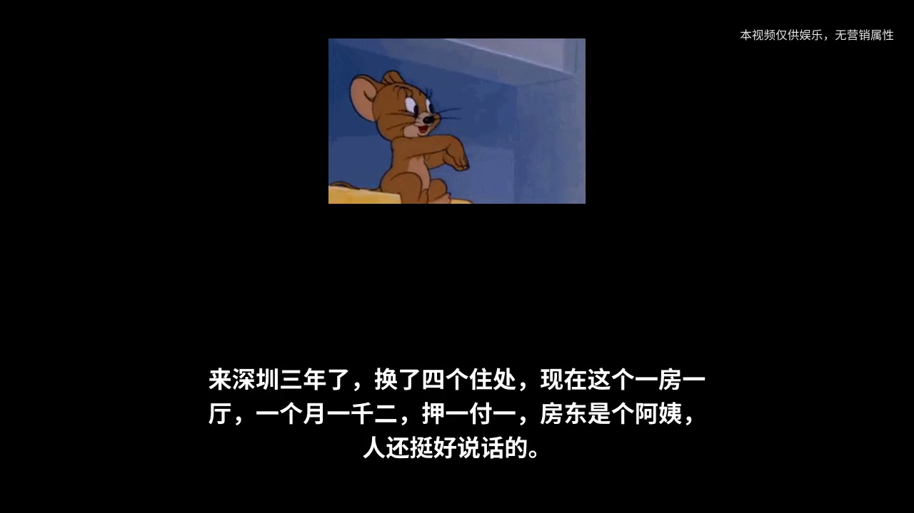

# sticker-voice-video

文案 → 配音 → 表情包（动态优先）→ 字幕 → 横屏成片。

一句话切一个表情包，黑底、底部大字字幕、右上角免责，横屏 1280×720。
就是那种“凌晨三点深圳福田……”的配音表情包视频，之前手动在剪映里
一张一张拼，现在一条命令出片。




## 效果

- 黑底，方形表情包居中，每句话切一张
- 底部白字粗体字幕，跟配音走；右上角“本视频仅供娱乐，无营销属性”
- 字幕按标点切成短分句，一段一段跟着配音出：配音读到“来深圳三年了，”
  只显示这一句，不会整句三行字一次全出来等它读完（出现时间按字数
  比例估，逗号处配音本来就会停顿，大体能对上）
- 每句话时长 = 该句配音时长 + 0.4 秒停顿，不用对齐模型
- 随机配图**优先真动图**（多帧 GIF），动图不够再拿静态补

## 快速开始

```bash
# 1. 依赖：Python 3.10+、ffmpeg（含 libx264、ASS 字幕）、Noto Sans CJK 字体
#    Ubuntu/Debian：sudo apt install ffmpeg fonts-noto-cjk

# 2. 拉表情包（ChineseBQB 精选分类，约 501MB）
bash scripts/fetch-stickers.sh
python3 scripts/build-animated-index.py   # 生成动图清单 animated-stickers.json

# 3. 写文案（见 example-project.json），出片
python3 meme_video.py example-project.json --out out.mp4
```

## project.json

```json
{
  "size": "horizontal",
  "voice": "volc-sajiao",
  "disclaimer": "本视频仅供娱乐，无营销属性",
  "pool": ["chinesebqb", "huaji", "user", "mine"],
  "seed": 7,
  "segments": [
    {"text": "凌晨三点深圳福田，三十块青旅床位，我悟了！"},
    {"text": "下一句……", "sticker": "stickers/mine/panda.jpg"},
    {"text": "这句用自己的录音", "audio": "my-voice-s2.mp3"}
  ]
}
```

- `segments[].text`：每句文案，一句一切一张表情包、一段字幕。
- `sticker` 不写就随机配，一条视频内不重复，日志会打印挑了哪张，
  想固定就把路径抄回那句。`seed` 固定随机结果，`pool` 指定用哪个包。
- `audio`：自备配音（自己录的、剪映导出的都行），有它就不走 TTS。
- `voice`：默认 `volc-sajiao`，也可每句单独指定。

## 配音

三种路，按稳的程度排：

1. **自备 audio 最稳**：每句给 `audio`，爱用什么音色用什么音色。
   剪映里的克隆音色（比如“曼波”）锁在剪映 App 里导不出来，
   想用它只能在剪映里生成音频后用 `audio` 接进来。
2. **火山 seed-tts-2.0**：把你的 TTS 命令配到环境变量
   `SVV_VOLC_TTS`，命令接受 `--text-file <txt> --output <mp3> --speaker <id>`，
   可以带解释器写，比如 `python3 /path/to/tts.py`。
   预设音色见 `meme_video.py` 里的 `VOICES`（撒娇学妹 / 甜美校园 / 刘飞）。
3. **edge-tts（免费）**：同理配 `SVV_EDGE_TTS`。

没配命令又没给 `audio` 时脚本直接报错，不会静默换音色。

### 用自己的复刻音色

想用自己的声音（比如复刻了自己或家人的声音）也很简单：

1. 在火山引擎控制台“声音复刻”里克隆，得到一个 `S_` 开头的 speaker ID。
   参考音频 10–30 秒干净朗读就行（一段自己录的音，或者一段已有配音）。
2. 在 `project.json` 里直接填这个 ID：`"voice": "S_你的ID"`，
   也可以每句单独指定。模板认 `S_` 开头的 ID，走 seed-icl-2.0。
   `zh_` 开头的火山预设音色 ID 同样可以直接填。
3. 注意：复刻音色只认克隆它的那个火山账号的 key，换别人的 key 会报
   资源未授权；也不要把别人的 `S_` ID 填进来，那不是你的声音。

## 表情包

- `scripts/fetch-stickers.sh` 从 [zhaoolee/ChineseBQB](https://github.com/zhaoolee/ChineseBQB)
  拉 41 个精选分类（白色小人、金馆长熊猫、猫和老鼠、喵星人……），
  真人、名人、政治类没拉。图片本身**不进本仓库**（版权 + 体积），
  用的时候自己拉；`stickers/` 已在 `.gitignore` 里。
- BQB 没有单独的“动态”分类，分类按角色分，`.gif` 后缀也不能当动态用
  （很多只是单帧图）。`build-animated-index.py` 按帧数筛真动图，
  本地 3250 张里真动图 831 张，动图最多的分类是白色小人 157、穿什么 119、
  猫和老鼠 91、金馆长熊猫 63、小幺鸡 50、汪蛋 45。

## 注意

- 这个视频只做横屏（1280×720），`vertical` 只是代码里留着的备用。
- 表情包里有汤姆猫、皮卡丘、海绵宝宝这类版权角色，免责声明去不掉这个风险，
  商用前自己掂量。
- 每句音频按“文案 + 音色” hash 缓存，改文案只重合改过的那句。

## License

MIT
